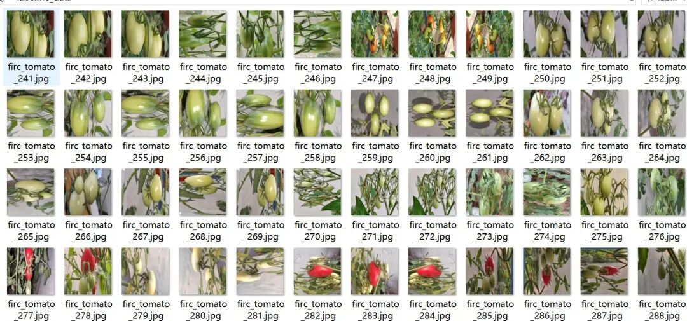
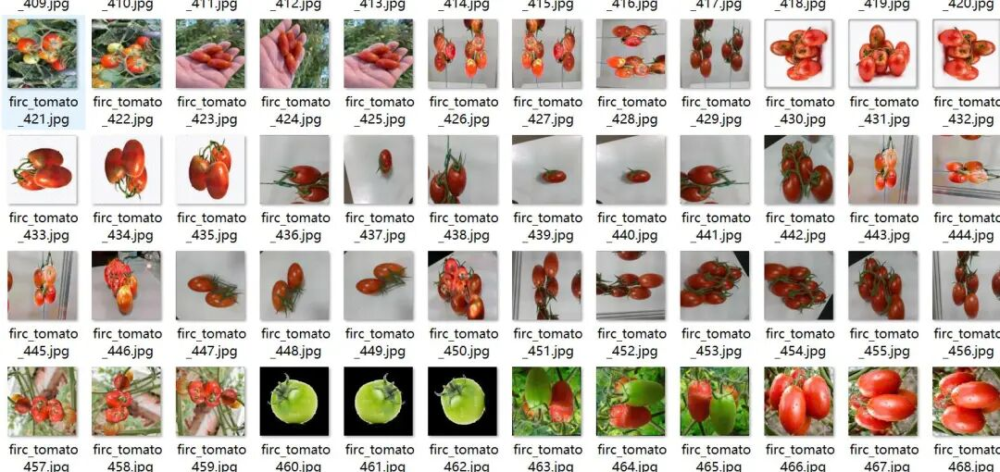
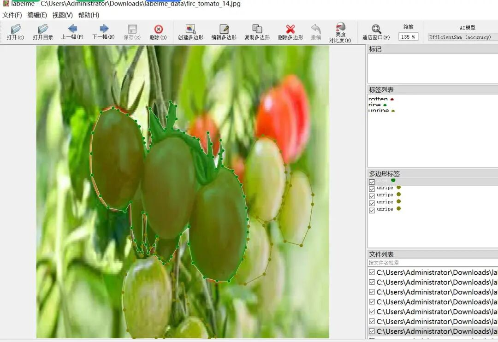
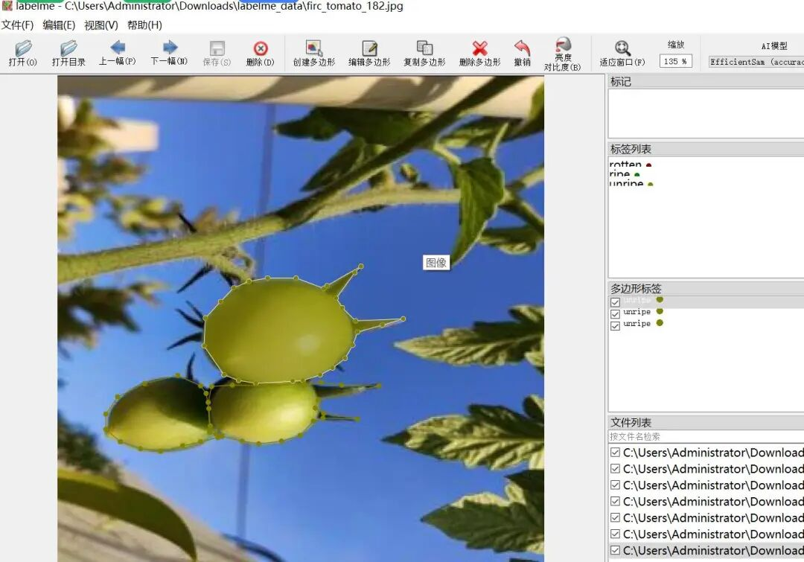

# Tomato ripening and rotting identification and segmentation dataset in labelme format, 1531 images with 3 categories

Some of the images in the dataset have been enhanced, and some tomatoes are grouped together into one region.

Dataset format: labelme format (without mask files, only including jpg images and corresponding json files)

Number of images (number of jpg files): 1531

Number of annotations (json file count): 1531

Label category count: 3

Annotation category names: ["rotten", "ripe", "unripe"]

Number of boxes labeled in each category:

rotten count = 2678

ripe count = 2058

unripe count = 1892

Using labeling tool: labelme=5.5.0

Annotation rules: Draw polygons around the categories.

Important Notice: The dataset can be opened and edited using LabelMe. For JSON datasets, one must convert them into mask or Yolo formats for semantic segmentation or instance segmentation.

Special : This dataset does not guarantee the accuracy or precision of the trained models or weight files. The dataset is provided with accurate and reasonable annotations only.

Image Preview:

Annotation example:

## Payment

Here is a pay link on Stripe ( https://buy.stripe.com/3cs8yP7sY87d0vu9AB ). Please contact me lonlonago@foxmail.com after funding $89, and I will send you a complete data files , thank you!

